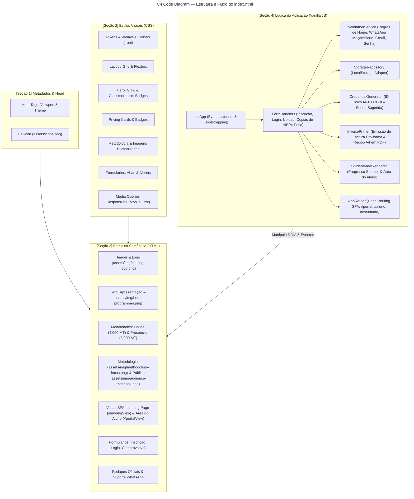

# ZEDECKS TRAINING — Programação Assistida por IA

> **Landing Page oficial & Portal de Inscrições** para o curso *"Programação Assistida por IA — Do Zero ao Júnior"*.

---

## 📌 Visão Geral do Projeto

Esta aplicação é uma solução *Single-File Clean Code* desenvolvida em tecnologias web nativas (**HTML5**, **CSS3** e **Vanilla JavaScript moderno**), sem dependência de frameworks externos ou bibliotecas pesadas.

O objetivo da página é apresentar a proposta pedagógica do treinamento da **Zedecks Training** (Moçambique), captar inscrições para as modalidades **Online** e **Presencial**, e disponibilizar uma **Área do Aluno** interativa para acompanhamento de status e upload de comprovativos com persistência local.

---

## 🏛️ C4 Code-Level Architecture

O arquivo principal [`index.html`](index.html) é estruturado de forma modular e desacoplada em 4 seções fundamentais:



---

## 📂 Organização Interna do [`index.html`](index.html)

Para máxima legibilidade, manutenibilidade e adesão rigorosa ao **Clean Code**, o arquivo único está dividido em blocos delimitados:

| Bloco | Identificador | Responsabilidade |
| :--- | :--- | :--- |
| **1** | `<!-- [SEÇÃO 1] METADADOS -->` | Metatags SEO, tema, título e link para o ícone favicon. |
| **2** | `<!-- [SEÇÃO 2] ESTILOS (CSS) -->` | Design system com tokens HSL/Hex, microanimações, glassmorphism e responsividade. |
| **3** | `<!-- [SEÇÃO 3] ESTRUTURA (HTML) -->` | Marcação semântica com tags `header`, `main`, `section`, `form`, `footer` e atributos de acessibilidade ARIA. |
| **4** | `<!-- [SEÇÃO 4] LÓGICA (JS) -->` | Módulo encapsulado (IIFE) com separação clara de responsabilidades (*Storage*, *Generators*, *Views*, *Handlers*). |

---

## ✨ Funcionalidades do Formulário & Portal do Aluno

### 1. Validações Estritas de Moçambique & UX
- **Nome Completo**: Auto-capitalização (Title Case), apenas caracteres alfabéticos latinos com acentos, sem números ou símbolos, espaço único entre palavras e até 52 caracteres.
- **WhatsApp / Telefone**: Exatamente 9 dígitos locais ou 13 se iniciado por `+258`, validando rigorosamente as operadoras moçambicanas (`82, 83, 84, 85, 86, 87, 88`).
- **E-mail**: Restrito exclusivamente a contas com domínio `@gmail.com`.
- **Perfil de Entrada**: Seleção direcionada para quem começa do Zero Absoluto, Iniciante ou Programador Tradicional querendo aliar IA.
- **Senha Híbrida**: O sistema sugere automaticamente uma senha alfanumérica segura (`0-9`, `a-z`, `A-Z`) com mínimo de 6 caracteres, permitindo edição livre pelo aluno.

### 2. Resumo, Factura Pró-forma A4 & Quitação
- **ID de Estudante Único**: Gerado na hora no padrão `IA-XXXXXX`, com verificação em tempo de execução para garantir não repetição.
- **Barra de Progresso (Stepper)**: 4 etapas dinâmicas (Inscrição Efetuada, Factura & Pagamento Pendente, Comprovativo Submetido, Vaga Confirmada).
- **Factura à Pagar Oficial**: Formatada em folha A4 com `@media print` para salvar direto como PDF de alta resolução pelo navegador (`window.print()`).
- **Cards de Pagamento Oficiais**: Coordenadas para M-Pesa (`+258 84 770 3309` · Titular: `EDMILSON M********O`), E-Mola (`+258 87 770 3308` · Titular: `EDMILSON ADELINO MUACIGARRO`) e Millennium BIM (NIB: `0001 0000 0038 5397 39457` · Titular: `EDMILSON ADELINO MUACIGARRO`), com botão de cópia com 1 clique e instrução obrigatória de menção do ID do aluno no motivo do pagamento.
- **Recibo de Quitação**: Disponível para download formal em A4 assim que a matrícula é validada.

### 3. Painel Executivo de Administração & Gestão de Vagas (`#admin` / `#gestao`)
- **Acesso Restrito**: Login protegido por senha mestre (`zedecks@admin`).
- **Métricas Analíticas em Tempo Real**: 4 cartões KPI com total de inscritos, receita total estimada em Meticais (MT), pendências e matrículas oficializadas.
- **Tabela de Candidatos**: Busca instantânea multicritério (Nome, ID, Telefone ou E-mail) e filtro por status.
- **Auditoria de Comprovativos**: Modal responsiva para inspeção visual do comprovativo enviado pelo aluno, com suporte integrado para imagens e visualizador embutido de arquivos PDF.
- **Aprovação e Reversão com 1 Clique**: Botões de confirmação direta que atualizam a barra do aluno para 100% e liberam o Recibo de Quitação.
- **Relatório Oficial em PDF (A4)**: Emissão de relatório institucional formal com cabeçalho Zedecks Training, data/hora da extração, tabela discriminada e campo para assinatura da Coordenação Geral.
- **Exportação CSV**: Download da base de dados completa estruturada em planilha com acentuação corrigida via UTF-8 BOM.
- **Integração em Nuvem Híbrida**: Pronto para Firebase Firestore em tempo real (`FIREBASE_CONFIG`), operando nativamente em `localStorage` quando não configurado.

## 🚀 Como Executar Localmente

### Pré-requisitos
Apenas um navegador web moderno e um interpretador Python ou Node.js para servir os arquivos estáticos.

### Faixa de Portas Recomendada
Conforme as diretrizes de infraestrutura para projetos pessoais no `WaysPessoais`, a porta alocada é **`2025`**:

```bash
# Navegar até o diretório do projeto
cd d:\ZEDECKLAB\WaysPessoais\landpages\inscricao-ia-curso

# Iniciar servidor estático
python -m http.server 2025
```

Acesse no navegador:
👉 **[http://localhost:2025](http://localhost:2025)**

---

## 🛡️ Políticas de Contribuição e Pull Requests

> [!IMPORTANT]
> **Este repositório NÃO aceita Pull Requests.**
>
> Por ser um projeto com design proprietário e regras de negócio específicas da **Zedecks Training**, qualquer Pull Request enviado será automaticamente recusado ou fechado sem mesclagem.

### 💡 Issues São Bem-Vindas
Se você encontrou algum erro visual, incompatibilidade de navegador, inconsistência ou tem uma sugestão de melhoria técnica, sinta-se à vontade para **abrir uma Issue**. A equipe avaliará e aplicará as correções pertinentes.

---

## ⚖️ Licença e Termos de Uso (Source-Available)

O código deste projeto é disponibilizado de forma aberta estritamente para **fins de consulta e auditoria técnica**.

- ❌ **Proibido Uso Comercial**: É expressamente vedada a comercialização, cobrança por este software ou utilização comercial sem consentimento prévio por escrito.
- ❌ **Proibida a Reutilização de Marca e Ativos**: Os logotipos, imagens de alunos/profissionais, textos institucionais e identidade visual da **Zedecks Training** são de propriedade exclusiva.
- ❌ **Proibida Criação de Derivados para Fins Públicos**: Você não tem permissão para clonar e publicar esta landing page sob outro nome para divulgar cursos próprios ou de terceiros.

Para mais detalhes, consulte o arquivo [`LICENSE.md`](LICENSE.md).

---

## 📜 Histórico de Versões
O registro detalhado de todas as alterações, lançamentos e notas de evolução técnica pode ser consultado no [`CHANGELOG.md`](CHANGELOG.md).

---

© 2026 **Zedecks Training** — Todos os direitos reservados.
Dúvidas ou suporte: [WhatsApp +258 84 770 3309](https://wa.me/258847703309).
